  

<h3 align="center">Connect with me</h3>

  
  
  

---

<h3 align="center">GitHub stats</h3>

---

<h3 align="center">Tech stack &amp; tools</h3>

---

<h3 align="center">Selected projects</h3>

| Проект | Что сделал | Ссылки |
| :--- | :--- | :--- |
| **SIMKA** | Магазин SIM и eSIM: каталог, заказы, оплата, управление через Telegram | [Код](https://github.com/AndrianDev0/simka-store) · [Сайт](https://simki.cc/) |
| **Магия прикосновений** | Сайт онлайн-курса, личный кабинет и управление доступом | [Код](https://github.com/AndrianDev0/magia-prikosnoveniy-course) |
| **Neryungri AI City** | Учебный прототип: обращения жителей, карта и аналитика | [Код](https://github.com/AndrianDev0/neryungri-ai-city) |
| **Sole Motion** | Интерактивный 3D-концепт магазина обуви | [Код](https://github.com/AndrianDev0/sole-motion) · [Демо](https://sole-motion-public.vercel.app/) |
| **NEBO** | Прототип сайта ресторана | [Код](https://github.com/AndrianDev0/nebo) |

---

<h3 align="center">Contribution activity</h3>

Учусь в ЮЯТК на «Информационных системах и программировании». Делаю проекты с помощью ИИ, проверяю решения и дорабатываю после запуска. <b>Открыт к работе и стажировке.</b>

О статистике и оформлении

Данные получены из GitHub API и обновляются ежедневно. Распределение языков отражает объём публичного кода, а не уровень владения. Дублирующий репозиторий портфолио исключён из подсчёта языков. Движущийся персонаж — декоративная анимация поверх настоящего календаря вкладов. SVG поддерживают настройку уменьшения движения.

Иконки технологий: [Skill Icons](https://github.com/tandpfun/skill-icons), лицензия MIT. Визуальная отправная точка: [профиль pangeran-droid](https://github.com/pangeran-droid); графика терминала и генератор статистики сделаны для этого профиля.

